<p align="center">
  <a href="https://github.com/singhkrish2607-sudo">
    
  </a>
</p>

<div align="center">


<br/><br/>

<a href="https://portfolio-site-966.app.orvisai.com/"></a>
<a href="https://www.linkedin.com/in/krish-singh-688884320/"></a>
<a href="mailto:singh.krish2003@gmail.com"></a>
<a href="https://x.com/krishsh26"></a>

</div>

<br/>


Hey there! I'm **Krish** — an engineer passionate about building high-performance **relational database systems**, scalable **ETL architectures**, and autonomous **Agentic AI workflows**.

- 🤖 **Agentic AI &amp; LLMs:** Engineering self-correcting code generation agents (leveraging iterative reflection loops in Python), Retrieval-Augmented Generation (RAG) knowledge systems, and vector search pipelines.
- 🗄️ **Relational Data &amp; Systems:** Designing normalized database ecosystems (PostgreSQL, MySQL, SQL Server), writing complex analytical queries (CTEs, subqueries, window functions), and modeling dimensional data warehouses.
- 💡 **Open Source &amp; Knowledge Sharing:** Active builder on GitHub and technical mentor, having guided 60+ developers through query debugging, database modeling, and schema optimization.
- 🌐 *For full career history, client case studies, and interactive demos, visit my [Live Portfolio](https://portfolio-site-966.app.orvisai.com/).*


<br/>

<div align="center">
  &nbsp;
  &nbsp;
  &nbsp;
  &nbsp;
  &nbsp;
  &nbsp;
  &nbsp;
  &nbsp;
  &nbsp;
  &nbsp;
  
</div>


<details open>
  <summary><b>📌 Open-Source Systems &amp; Repositories</b></summary>
  <br/>

<a href="https://github.com/singhkrish2607-sudo/Reflective-Self-Correcting-Code-Generation-Agent">
  
</a>

<a href="https://github.com/singhkrish2607-sudo/ChatBot-using-RAG">
  
</a>

<a href="https://github.com/singhkrish2607-sudo/SQL-data-warehouse-project">
  
</a>

<a href="https://github.com/singhkrish2607-sudo/Zepto-Data-Analysis-SQL-Project">
  
</a>

<a href="https://github.com/singhkrish2607-sudo/Bus_booking_analysis">
  
</a>

<a href="https://github.com/singhkrish2607-sudo/portfolio">
  
</a>

</details>

Explore all public codebases directly across my [GitHub Repositories](https://github.com/singhkrish2607-sudo?tab=repositories).


<div align="center">


<br/><br/>

<!-- GitHub Streak Stats (Seamless GitHub Dark background #0D1117, bright electric cyan & white text) -->
<a href="https://github.com/singhkrish2607-sudo">
  
</a>

<br/><br/>

<!-- GitHub Profile Summary Cards (github_dark theme: native #0d1117 background with vibrant official language chart colors) -->
<p align="center">
  
  
  
</p>

<p align="center">
  
</p>

<!-- Live Contribution Heatmap (Electric Neon Cyan) -->
<picture>
  <source media="(prefers-color-scheme: dark)" srcset="https://ghchart.rshah.org/00D2FF/singhkrish2607-sudo">
  
</picture>

<br/><br/>

<!-- Random Dev Quote (GitHub Dark background #0D1117, bright cyan quote, white author) -->
<a href="https://github.com/singhkrish2607-sudo">
  
</a>

</div>

<br/>

<div align="center">

```diff
+========================================================================+
+  KRISH SINGH // SYSTEM ARCHITECTURE & DATA ENGINEERING RUNTIME        +
+========================================================================+
@@  "Code without tests is like data without constraints — fragile."   @@
@@  "While(!success) { execute(); inspect(); reflect(); self_correct(); }" @@
+========================================================================+
```

</div>


<div align="center">

<a href="https://portfolio-site-966.app.orvisai.com/"></a>
<a href="https://www.linkedin.com/in/krish-singh-688884320/"></a>
<a href="mailto:singh.krish2003@gmail.com"></a>
<a href="https://x.com/krishsh26"></a>

<br/>


</div>
