<p align="center">
  <a href="https://github.com/singhkrish2607-sudo">
    
  </a>
</p>

<div align="center">



<br/><br/>

<a href="https://www.linkedin.com/in/krish-singh-688884320/"></a>
<a href="https://portfolio-site-966.app.orvisai.com/"></a>
<a href="mailto:singh.krish2003@gmail.com"></a>
<a href="https://x.com/krishsh26"></a>

<br/><br/>


</div>


I am a **SQL Developer, Data Analyst, and Agentic AI Developer** based in Uttar Pradesh, India, with **2+ years of hands-on production experience** working with PostgreSQL, MySQL, and SQL Server. Currently at **Cupule Technologies Pvt. Ltd.**, I engineer complex relational queries (multi-table joins, CTEs, subqueries, and window functions), audit database schemas against Software Requirement Specifications (SRS), and build comprehensive normalized data models with strict referential integrity. In addition, I have trained and mentored **60–70 learners** in advanced SQL, query debugging, and data modeling.

Bridging enterprise data platforms with modern artificial intelligence, I design **autonomous agentic workflows** and **Retrieval-Augmented Generation (RAG)** systems in Python. My AI engineering focuses on self-correcting agent loops (using the reflection pattern to iteratively generate, test, and debug code) and context-aware conversational assistants backed by vector search. I hold a **B.Sc. in Mathematics** from Bundelkhand University (2024), bringing deep algorithmic rigor and quantitative problem-solving to every system I build. I am available as an **immediate joiner** for high-impact roles.


<details open>
  <summary><b>📌 Featured Repositories &amp; Architectures</b></summary>
  <br/>

<a href="https://github.com/singhkrish2607-sudo/Reflective-Self-Correcting-Code-Generation-Agent">
  
</a>

<a href="https://github.com/singhkrish2607-sudo/ChatBot-using-RAG">
  
</a>

<a href="https://github.com/singhkrish2607-sudo/SQL-data-warehouse-project">
  
</a>

<a href="https://github.com/singhkrish2607-sudo/Zepto-Data-Analysis-SQL-Project">
  
</a>

<a href="https://github.com/singhkrish2607-sudo/Bus_booking_analysis">
  
</a>

<a href="https://github.com/singhkrish2607-sudo/portfolio">
  
</a>

</details>

Explore more open-source repositories and live deployments directly on my [Interactive Portfolio](https://portfolio-site-966.app.orvisai.com/) or across my [GitHub Repositories](https://github.com/singhkrish2607-sudo?tab=repositories).


<br/>

<div align="center">
  &nbsp;
  &nbsp;
  &nbsp;
  &nbsp;
  &nbsp;
  &nbsp;
  &nbsp;
  &nbsp;
  &nbsp;
  &nbsp;
  
</div>


<div align="center">


<br/><br/>

<!-- GitHub Streak Stats -->
<a href="https://github.com/singhkrish2607-sudo">
  
</a>

<br/><br/>

<!-- GitHub Profile Summary Cards (Reference: Ahtisham-1214) -->
<p align="center">
  
  
  
</p>

<p align="center">
  
</p>

<!-- Live Contribution Heatmap -->
<picture>
  <source media="(prefers-color-scheme: dark)" srcset="https://ghchart.rshah.org/00D2FF/singhkrish2607-sudo">
  
</picture>

<br/><br/>

<!-- Random Dev Quote (Reference: Ahtisham-1214) -->
<a href="https://github.com/singhkrish2607-sudo">
  
</a>

</div>

<br/>

<div align="center">

```diff
+========================================================================+
+  KRISH SINGH // SYSTEM ARCHITECTURE & DATA ENGINEERING RUNTIME        +
+========================================================================+
@@  "Code without tests is like data without constraints — fragile."   @@
@@  "While(!success) { execute(); inspect(); reflect(); self_correct(); }" @@
+========================================================================+
```

</div>


<div align="center">

<a href="https://www.linkedin.com/in/krish-singh-688884320/"></a>
<a href="https://portfolio-site-966.app.orvisai.com/"></a>
<a href="mailto:singh.krish2003@gmail.com"></a>
<a href="https://x.com/krishsh26"></a>

<br/>


</div>
