  

  

I am a **SQL Developer, Data Analyst, and Agentic AI Developer** based in Uttar Pradesh, India, with **2+ years of hands-on production experience** working with PostgreSQL, MySQL, and SQL Server. Currently at **Cupule Technologies Pvt. Ltd.**, I engineer complex relational queries (multi-table joins, CTEs, subqueries, and window functions), audit database schemas against Software Requirement Specifications (SRS), and build comprehensive normalized data models with strict referential integrity. In addition, I have trained and mentored **60–70 learners** in advanced SQL, query debugging, and data modeling.

Bridging enterprise data platforms with modern artificial intelligence, I design **autonomous agentic workflows** and **Retrieval-Augmented Generation (RAG)** systems in Python. My AI engineering focuses on self-correcting agent loops (using the reflection pattern to iteratively generate, test, and debug code) and context-aware conversational assistants backed by vector search. I hold a **B.Sc. in Mathematics** from Bundelkhand University (2024), bringing deep algorithmic rigor and quantitative problem-solving to every system I build. I am available as an **immediate joiner** for high-impact roles.

Explore more open-source repositories and live deployments directly on my [Interactive Portfolio](https://portfolio-site-966.app.orvisai.com/) or across my [GitHub Repositories](https://github.com/singhkrish2607-sudo?tab=repositories).

<picture>
  <source media="(prefers-color-scheme: dark)" srcset="https://ghchart.rshah.org/00D2FF/singhkrish2607-sudo">
  
</picture>

  

<picture>
  <source media="(prefers-color-scheme: dark)" srcset="https://github-readme-stats.vercel.app/api?username=singhkrish2607-sudo&amp;show_icons=true&amp;hide_border=true&amp;bg_color=080C14&amp;title_color=38BDF8&amp;text_color=F8FAFC&amp;icon_color=00D2FF&amp;ring_color=38BDF8">
  
</picture>

 

